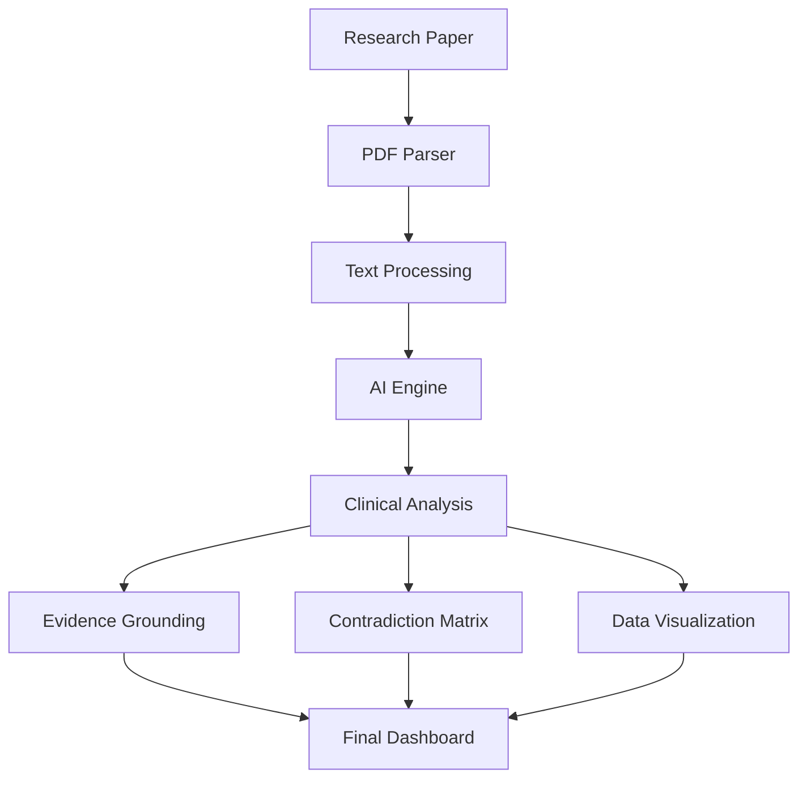

# git-learning
First Github Repo By ~
 Mayank Mishra
## System Architecture

%3CmxGraphModel%3E%3Croot%3E%3CmxCell%20id%3D%220%22%2F%3E%3CmxCell%20id%3D%221%22%20parent%3D%220%22%2F%3E%3CUserObject%20label%3D%22%22%20mermaidData%3D%22%7B%26%2310%3B%20%20%26quot%3Bdata%26quot%3B%3A%20%26quot%3B%5Cn%5Cnflowchart%20TD%5Cn%20%20%20%20A%5BResearch%20Paper%5D%20--%26gt%3B%20B%5BPDF%20Parser%5D%5Cn%20%20%20%20B%20--%26gt%3B%20C%5BText%20Processing%5D%5Cn%20%20%20%20C%20--%26gt%3B%20D%5BAI%20Engine%5D%5Cn%20%20%20%20D%20--%26gt%3B%20E%5BClinical%20Analysis%5D%5Cn%20%20%20%20E%20--%26gt%3B%20F%5BEvidence%20Grounding%5D%5Cn%20%20%20%20E%20--%26gt%3B%20G%5BContradiction%20Matrix%5D%5Cn%20%20%20%20E%20--%26gt%3B%20H%5BData%20Visualization%5D%5Cn%20%20%20%20F%20--%26gt%3B%20I%5BFinal%20Dashboard%5D%5Cn%20%20%20%20G%20--%26gt%3B%20I%5Cn%20%20%20%20H%20--%26gt%3B%20I%5Cn%5Cn%26quot%3B%2C%26%2310%3B%20%20%26quot%3Bconfig%26quot%3B%3A%20null%2C%26%2310%3B%20%20%26quot%3Bversion%26quot%3B%3A%20%26quot%3B12%26quot%3B%26%2310%3B%7D%22%20id%3D%222%22%3E%3CmxCell%20connectable%3D%220%22%20parent%3D%221%22%20style%3D%22group%3BtransparentBounds%3D1%3BeditIcon%3D1%3BlockedGroup%3D0%3BgroupPadding%3D10%3BfillColor%3D%23ffe6cc%3BstrokeColor%3D%23d79b00%3B%22%20vertex%3D%221%22%3E%3CmxGeometry%20as%3D%22geometry%22%2F%3E%3C%2FmxCell%3E%3C%2FUserObject%3E%3CUserObject%20label%3D%22Research%20Paper%22%20mermaidId%3D%22n%3AA%22%20mermaidBaseStyle%3D%22html%3D1%3BwhiteSpace%3Dwrap%3BstrokeWidth%3D2%3BfillColor%3D%23ffffff%3BstrokeColor%3D%2328253D%3BfontColor%3D%2328253D%3BfontFamily%3DRecursive%3BfontSize%3D14%3Bshadow%3D1%3BshadowColor%3D%23000000%3BshadowOffsetX%3D4%3BshadowOffsetY%3D4%3BshadowBlur%3D0%3BshadowOpacity%3D6%3B%22%20mermaidBaseValue%3D%22Research%20Paper%22%20id%3D%223%22%3E%3CmxCell%20parent%3D%222%22%20style%3D%22html%3D1%3BwhiteSpace%3Dwrap%3BstrokeWidth%3D2%3BfillColor%3D%23ffffff%3BstrokeColor%3D%2328253D%3BfontColor%3D%2328253D%3BfontFamily%3DRecursive%3BfontSize%3D14%3Bshadow%3D1%3BshadowColor%3D%23000000%3BshadowOffsetX%3D4%3BshadowOffsetY%3D4%3BshadowBlur%3D0%3BshadowOpacity%3D6%3BfontSource%3Dhttps%253A%252F%252Ffonts.googleapis.com%252Fcss%253Ffamily%253DRecursive%3B%22%20vertex%3D%221%22%3E%3CmxGeometry%20height%3D%2245%22%20width%3D%22152%22%20x%3D%22222%22%20y%3D%2230%22%20as%3D%22geometry%22%2F%3E%3C%2FmxCell%3E%3C%2FUserObject%3E%3CUserObject%20label%3D%22PDF%20Parser%22%20mermaidId%3D%22n%3AB%22%20mermaidBaseStyle%3D%22html%3D1%3BwhiteSpace%3Dwrap%3BstrokeWidth%3D2%3BfillColor%3D%23ffffff%3BstrokeColor%3D%2328253D%3BfontColor%3D%2328253D%3BfontFamily%3DRecursive%3BfontSize%3D14%3Bshadow%3D1%3BshadowColor%3D%23000000%3BshadowOffsetX%3D4%3BshadowOffsetY%3D4%3BshadowBlur%3D0%3BshadowOpacity%3D6%3B%22%20mermaidBaseValue%3D%22PDF%20Parser%22%20id%3D%224%22%3E%3CmxCell%20parent%3D%222%22%20style%3D%22html%3D1%3BwhiteSpace%3Dwrap%3BstrokeWidth%3D2%3BfillColor%3D%23ffffff%3BstrokeColor%3D%2328253D%3BfontColor%3D%2328253D%3BfontFamily%3DRecursive%3BfontSize%3D14%3Bshadow%3D1%3BshadowColor%3D%23000000%3BshadowOffsetX%3D4%3BshadowOffsetY%3D4%3BshadowBlur%3D0%3BshadowOpacity%3D6%3BfontSource%3Dhttps%253A%252F%252Ffonts.googleapis.com%252Fcss%253Ffamily%253DRecursive%3B%22%20vertex%3D%221%22%3E%3CmxGeometry%20height%3D%2245%22%20width%3D%22152%22%20x%3D%22222%22%20y%3D%22115%22%20as%3D%22geometry%22%2F%3E%3C%2FmxCell%3E%3C%2FUserObject%3E%3CUserObject%20label%3D%22Text%20Processing%22%20mermaidId%3D%22n%3AC%22%20mermaidBaseStyle%3D%22html%3D1%3BwhiteSpace%3Dwrap%3BstrokeWidth%3D2%3BfillColor%3D%23ffffff%3BstrokeColor%3D%2328253D%3BfontColor%3D%2328253D%3BfontFamily%3DRecursive%3BfontSize%3D14%3Bshadow%3D1%3BshadowColor%3D%23000000%3BshadowOffsetX%3D4%3BshadowOffsetY%3D4%3BshadowBlur%3D0%3BshadowOpacity%3D6%3B%22%20mermaidBaseValue%3D%22Text%20Processing%22%20id%3D%225%22%3E%3CmxCell%20parent%3D%222%22%20style%3D%22html%3D1%3BwhiteSpace%3Dwrap%3BstrokeWidth%3D2%3BfillColor%3D%23ffffff%3BstrokeColor%3D%2328253D%3BfontColor%3D%2328253D%3BfontFamily%3DRecursive%3BfontSize%3D14%3Bshadow%3D1%3BshadowColor%3D%23000000%3BshadowOffsetX%3D4%3BshadowOffsetY%3D4%3BshadowBlur%3D0%3BshadowOpacity%3D6%3BfontSource%3Dhttps%253A%252F%252Ffonts.googleapis.com%252Fcss%253Ffamily%253DRecursive%3B%22%20vertex%3D%221%22%3E%3CmxGeometry%20height%3D%2245%22%20width%3D%22152%22%20x%3D%22222%22%20y%3D%22201%22%20as%3D%22geometry%22%2F%3E%3C%2FmxCell%3E%3C%2FUserObject%3E%3CUserObject%20label%3D%22AI%20Engine%22%20mermaidId%3D%22n%3AD%22%20mermaidBaseStyle%3D%22html%3D1%3BwhiteSpace%3Dwrap%3BstrokeWidth%3D2%3BfillColor%3D%23ffffff%3BstrokeColor%3D%2328253D%3BfontColor%3D%2328253D%3BfontFamily%3DRecursive%3BfontSize%3D14%3Bshadow%3D1%3BshadowColor%3D%23000000%3BshadowOffsetX%3D4%3BshadowOffsetY%3D4%3BshadowBlur%3D0%3BshadowOpacity%3D6%3B%22%20mermaidBaseValue%3D%22AI%20Engine%22%20id%3D%226%22%3E%3CmxCell%20parent%3D%222%22%20style%3D%22html%3D1%3BwhiteSpace%3Dwrap%3BstrokeWidth%3D2%3BfillColor%3D%23ffffff%3BstrokeColor%3D%2328253D%3BfontColor%3D%2328253D%3BfontFamily%3DRecursive%3BfontSize%3D14%3Bshadow%3D1%3BshadowColor%3D%23000000%3BshadowOffsetX%3D4%3BshadowOffsetY%3D4%3BshadowBlur%3D0%3BshadowOpacity%3D6%3BfontSource%3Dhttps%253A%252F%252Ffonts.googleapis.com%252Fcss%253Ffamily%253DRecursive%3B%22%20vertex%3D%221%22%3E%3CmxGeometry%20height%3D%2245%22%20width%3D%22152%22%20x%3D%22222%22%20y%3D%22286%22%20as%3D%22geometry%22%2F%3E%3C%2FmxCell%3E%3C%2FUserObject%3E%3CUserObject%20label%3D%22Clinical%20Analysis%22%20mermaidId%3D%22n%3AE%22%20mermaidBaseStyle%3D%22html%3D1%3BwhiteSpace%3Dwrap%3BstrokeWidth%3D2%3BfillColor%3D%23ffffff%3BstrokeColor%3D%2328253D%3BfontColor%3D%2328253D%3BfontFamily%3DRecursive%3BfontSize%3D14%3Bshadow%3D1%3BshadowColor%3D%23000000%3BshadowOffsetX%3D4%3BshadowOffsetY%3D4%3BshadowBlur%3D0%3BshadowOpacity%3D6%3B%22%20mermaidBaseValue%3D%22Clinical%20Analysis%22%20id%3D%227%22%3E%3CmxCell%20parent%3D%222%22%20style%3D%22html%3D1%3BwhiteSpace%3Dwrap%3BstrokeWidth%3D2%3BfillColor%3D%23ffffff%3BstrokeColor%3D%2328253D%3BfontColor%3D%2328253D%3BfontFamily%3DRecursive%3BfontSize%3D14%3Bshadow%3D1%3BshadowColor%3D%23000000%3BshadowOffsetX%3D4%3BshadowOffsetY%3D4%3BshadowBlur%3D0%3BshadowOpacity%3D6%3BfontSource%3Dhttps%253A%252F%252Ffonts.googleapis.com%252Fcss%253Ffamily%253DRecursive%3B%22%20vertex%3D%221%22%3E%3CmxGeometry%20height%3D%2245%22%20width%3D%22152%22%20x%3D%22222%22%20y%3D%22371%22%20as%3D%22geometry%22%2F%3E%3C%2FmxCell%3E%3C%2FUserObject%3E%3CUserObject%20label%3D%22Evidence%20Grounding%22%20mermaidId%3D%22n%3AF%22%20mermaidBaseStyle%3D%22html%3D1%3BwhiteSpace%3Dwrap%3BstrokeWidth%3D2%3BfillColor%3D%23ffffff%3BstrokeColor%3D%2328253D%3BfontColor%3D%2328253D%3BfontFamily%3DRecursive%3BfontSize%3D14%3Bshadow%3D1%3BshadowColor%3D%23000000%3BshadowOffsetX%3D4%3BshadowOffsetY%3D4%3BshadowBlur%3D0%3BshadowOpacity%3D6%3B%22%20mermaidBaseValue%3D%22Evidence%20Grounding%22%20id%3D%228%22%3E%3CmxCell%20parent%3D%222%22%20style%3D%22html%3D1%3BwhiteSpace%3Dwrap%3BstrokeWidth%3D2%3BfillColor%3D%23ffffff%3BstrokeColor%3D%2328253D%3BfontColor%3D%2328253D%3BfontFamily%3DRecursive%3BfontSize%3D14%3Bshadow%3D1%3BshadowColor%3D%23000000%3BshadowOffsetX%3D4%3BshadowOffsetY%3D4%3BshadowBlur%3D0%3BshadowOpacity%3D6%3BlabelWidth%3D120%3BfontSource%3Dhttps%253A%252F%252Ffonts.googleapis.com%252Fcss%253Ffamily%253DRecursive%3B%22%20vertex%3D%221%22%3E%3CmxGeometry%20height%3D%2267%22%20width%3D%22152%22%20x%3D%2230%22%20y%3D%22456%22%20as%3D%22geometry%22%2F%3E%3C%2FmxCell%3E%3C%2FUserObject%3E%3CUserObject%20label%3D%22Contradiction%20Matrix%22%20mermaidId%3D%22n%3AG%22%20mermaidBaseStyle%3D%22html%3D1%3BwhiteSpace%3Dwrap%3BstrokeWidth%3D2%3BfillColor%3D%23ffffff%3BstrokeColor%3D%2328253D%3BfontColor%3D%2328253D%3BfontFamily%3DRecursive%3BfontSize%3D14%3Bshadow%3D1%3BshadowColor%3D%23000000%3BshadowOffsetX%3D4%3BshadowOffsetY%3D4%3BshadowBlur%3D0%3BshadowOpacity%3D6%3B%22%20mermaidBaseValue%3D%22Contradiction%20Matrix%22%20id%3D%229%22%3E%3CmxCell%20parent%3D%222%22%20style%3D%22html%3D1%3BwhiteSpace%3Dwrap%3BstrokeWidth%3D2%3BfillColor%3D%23ffffff%3BstrokeColor%3D%2328253D%3BfontColor%3D%2328253D%3BfontFamily%3DRecursive%3BfontSize%3D14%3Bshadow%3D1%3BshadowColor%3D%23000000%3BshadowOffsetX%3D4%3BshadowOffsetY%3D4%3BshadowBlur%3D0%3BshadowOpacity%3D6%3BlabelWidth%3D120%3BfontSource%3Dhttps%253A%252F%252Ffonts.googleapis.com%252Fcss%253Ffamily%253DRecursive%3B%22%20vertex%3D%221%22%3E%3CmxGeometry%20height%3D%2267%22%20width%3D%22152%22%20x%3D%22222%22%20y%3D%22456%22%20as%3D%22geometry%22%2F%3E%3C%2FmxCell%3E%3C%2FUserObject%3E%3CUserObject%20label%3D%22Data%20Visualization%22%20mermaidId%3D%22n%3AH%22%20mermaidBaseStyle%3D%22html%3D1%3BwhiteSpace%3Dwrap%3BstrokeWidth%3D2%3BfillColor%3D%23ffffff%3BstrokeColor%3D%2328253D%3BfontColor%3D%2328253D%3BfontFamily%3DRecursive%3BfontSize%3D14%3Bshadow%3D1%3BshadowColor%3D%23000000%3BshadowOffsetX%3D4%3BshadowOffsetY%3D4%3BshadowBlur%3D0%3BshadowOpacity%3D6%3B%22%20mermaidBaseValue%3D%22Data%20Visualization%22%20id%3D%2210%22%3E%3CmxCell%20parent%3D%222%22%20style%3D%22html%3D1%3BwhiteSpace%3Dwrap%3BstrokeWidth%3D2%3BfillColor%3D%23ffffff%3BstrokeColor%3D%2328253D%3BfontColor%3D%2328253D%3BfontFamily%3DRecursive%3BfontSize%3D14%3Bshadow%3D1%3BshadowColor%3D%23000000%3BshadowOffsetX%3D4%3BshadowOffsetY%3D4%3BshadowBlur%3D0%3BshadowOpacity%3D6%3BlabelWidth%3D120%3BfontSource%3Dhttps%253A%252F%252Ffonts.googleapis.com%252Fcss%253Ffamily%253DRecursive%3B%22%20vertex%3D%221%22%3E%3CmxGeometry%20height%3D%2267%22%20width%3D%22152%22%20x%3D%22414%22%20y%3D%22456%22%20as%3D%22geometry%22%2F%3E%3C%2FmxCell%3E%3C%2FUserObject%3E%3CUserObject%20label%3D%22Final%20Dashboard%22%20mermaidId%3D%22n%3AI%22%20mermaidBaseStyle%3D%22html%3D1%3BwhiteSpace%3Dwrap%3BstrokeWidth%3D2%3BfillColor%3D%23ffffff%3BstrokeColor%3D%2328253D%3BfontColor%3D%2328253D%3BfontFamily%3DRecursive%3BfontSize%3D14%3Bshadow%3D1%3BshadowColor%3D%23000000%3BshadowOffsetX%3D4%3BshadowOffsetY%3D4%3BshadowBlur%3D0%3BshadowOpacity%3D6%3B%22%20mermaidBaseValue%3D%22Final%20Dashboard%22%20id%3D%2211%22%3E%3CmxCell%20parent%3D%222%22%20style%3D%22html%3D1%3BwhiteSpace%3Dwrap%3BstrokeWidth%3D2%3BfillColor%3D%23ffffff%3BstrokeColor%3D%2328253D%3BfontColor%3D%2328253D%3BfontFamily%3DRecursive%3BfontSize%3D14%3Bshadow%3D1%3BshadowColor%3D%23000000%3BshadowOffsetX%3D4%3BshadowOffsetY%3D4%3BshadowBlur%3D0%3BshadowOpacity%3D6%3BfontSource%3Dhttps%253A%252F%252Ffonts.googleapis.com%252Fcss%253Ffamily%253DRecursive%3B%22%20vertex%3D%221%22%3E%3CmxGeometry%20height%3D%2245%22%20width%3D%22152%22%20x%3D%22222%22%20y%3D%22563%22%20as%3D%22geometry%22%2F%3E%3C%2FmxCell%3E%3C%2FUserObject%3E%3CUserObject%20label%3D%22%22%20mermaidId%3D%22e%3AA-%26gt%3BB%230%22%20mermaidBaseStyle%3D%22edgeStyle%3DorthogonalEdgeStyle%3Brounded%3D1%3Bcurved%3D0%3BstartArrow%3Dnone%3BendArrow%3Dblock%3BendSize%3D8%3BjumpStyle%3Darc%3BjumpSize%3D12%3BstrokeColor%3D%23000000%3BexitX%3D0.5%3BexitY%3D1%3BentryX%3D0.5%3BentryY%3D0.01%3BstrokeWidth%3D2%3BtargetPerimeterSpacing%3D4%3B%22%20mermaidBaseValue%3D%22%22%20id%3D%2212%22%3E%3CmxCell%20edge%3D%221%22%20parent%3D%222%22%20source%3D%223%22%20style%3D%22edgeStyle%3DorthogonalEdgeStyle%3Brounded%3D1%3Bcurved%3D0%3BstartArrow%3Dnone%3BendArrow%3Dblock%3BendSize%3D8%3BjumpStyle%3Darc%3BjumpSize%3D12%3BstrokeColor%3D%23000000%3BexitX%3D0.5%3BexitY%3D1%3BentryX%3D0.5%3BentryY%3D0.01%3BstrokeWidth%3D2%3BtargetPerimeterSpacing%3D4%3B%22%20target%3D%224%22%3E%3CmxGeometry%20relative%3D%221%22%20as%3D%22geometry%22%3E%3CArray%20as%3D%22points%22%2F%3E%3C%2FmxGeometry%3E%3C%2FmxCell%3E%3C%2FUserObject%3E%3CUserObject%20label%3D%22%22%20mermaidId%3D%22e%3AB-%26gt%3BC%230%22%20mermaidBaseStyle%3D%22edgeStyle%3DorthogonalEdgeStyle%3Brounded%3D1%3Bcurved%3D0%3BstartArrow%3Dnone%3BendArrow%3Dblock%3BendSize%3D8%3BjumpStyle%3Darc%3BjumpSize%3D12%3BstrokeColor%3D%23000000%3BexitX%3D0.5%3BexitY%3D1%3BentryX%3D0.5%3BentryY%3D0%3BstrokeWidth%3D2%3BtargetPerimeterSpacing%3D4%3B%22%20mermaidBaseValue%3D%22%22%20id%3D%2213%22%3E%3CmxCell%20edge%3D%221%22%20parent%3D%222%22%20source%3D%224%22%20style%3D%22edgeStyle%3DorthogonalEdgeStyle%3Brounded%3D1%3Bcurved%3D0%3BstartArrow%3Dnone%3BendArrow%3Dblock%3BendSize%3D8%3BjumpStyle%3Darc%3BjumpSize%3D12%3BstrokeColor%3D%23000000%3BexitX%3D0.5%3BexitY%3D1%3BentryX%3D0.5%3BentryY%3D0%3BstrokeWidth%3D2%3BtargetPerimeterSpacing%3D4%3B%22%20target%3D%225%22%3E%3CmxGeometry%20relative%3D%221%22%20as%3D%22geometry%22%3E%3CArray%20as%3D%22points%22%2F%3E%3C%2FmxGeometry%3E%3C%2FmxCell%3E%3C%2FUserObject%3E%3CUserObject%20label%3D%22%22%20mermaidId%3D%22e%3AC-%26gt%3BD%230%22%20mermaidBaseStyle%3D%22edgeStyle%3DorthogonalEdgeStyle%3Brounded%3D1%3Bcurved%3D0%3BstartArrow%3Dnone%3BendArrow%3Dblock%3BendSize%3D8%3BjumpStyle%3Darc%3BjumpSize%3D12%3BstrokeColor%3D%23000000%3BexitX%3D0.5%3BexitY%3D0.99%3BentryX%3D0.5%3BentryY%3D0%3BstrokeWidth%3D2%3BtargetPerimeterSpacing%3D4%3B%22%20mermaidBaseValue%3D%22%22%20id%3D%2214%22%3E%3CmxCell%20edge%3D%221%22%20parent%3D%222%22%20source%3D%225%22%20style%3D%22edgeStyle%3DorthogonalEdgeStyle%3Brounded%3D1%3Bcurved%3D0%3BstartArrow%3Dnone%3BendArrow%3Dblock%3BendSize%3D8%3BjumpStyle%3Darc%3BjumpSize%3D12%3BstrokeColor%3D%23000000%3BexitX%3D0.5%3BexitY%3D0.99%3BentryX%3D0.5%3BentryY%3D0%3BstrokeWidth%3D2%3BtargetPerimeterSpacing%3D4%3B%22%20target%3D%226%22%3E%3CmxGeometry%20relative%3D%221%22%20as%3D%22geometry%22%3E%3CArray%20as%3D%22points%22%2F%3E%3C%2FmxGeometry%3E%3C%2FmxCell%3E%3C%2FUserObject%3E%3CUserObject%20label%3D%22%22%20mermaidId%3D%22e%3AD-%26gt%3BE%230%22%20mermaidBaseStyle%3D%22edgeStyle%3DorthogonalEdgeStyle%3Brounded%3D1%3Bcurved%3D0%3BstartArrow%3Dnone%3BendArrow%3Dblock%3BendSize%3D8%3BjumpStyle%3Darc%3BjumpSize%3D12%3BstrokeColor%3D%23000000%3BexitX%3D0.5%3BexitY%3D1%3BentryX%3D0.5%3BentryY%3D0%3BstrokeWidth%3D2%3BtargetPerimeterSpacing%3D4%3B%22%20mermaidBaseValue%3D%22%22%20id%3D%2215%22%3E%3CmxCell%20edge%3D%221%22%20parent%3D%222%22%20source%3D%226%22%20style%3D%22edgeStyle%3DorthogonalEdgeStyle%3Brounded%3D1%3Bcurved%3D0%3BstartArrow%3Dnone%3BendArrow%3Dblock%3BendSize%3D8%3BjumpStyle%3Darc%3BjumpSize%3D12%3BstrokeColor%3D%23000000%3BexitX%3D0.5%3BexitY%3D1%3BentryX%3D0.5%3BentryY%3D0%3BstrokeWidth%3D2%3BtargetPerimeterSpacing%3D4%3B%22%20target%3D%227%22%3E%3CmxGeometry%20relative%3D%221%22%20as%3D%22geometry%22%3E%3CArray%20as%3D%22points%22%2F%3E%3C%2FmxGeometry%3E%3C%2FmxCell%3E%3C%2FUserObject%3E%3CUserObject%20label%3D%22%22%20mermaidId%3D%22e%3AE-%26gt%3BF%230%22%20mermaidBaseStyle%3D%22edgeStyle%3DorthogonalEdgeStyle%3Brounded%3D1%3Bcurved%3D0%3BstartArrow%3Dnone%3BendArrow%3Dblock%3BendSize%3D8%3BjumpStyle%3Darc%3BjumpSize%3D12%3BstrokeColor%3D%23000000%3BexitX%3D0.28%3BexitY%3D1%3BentryX%3D0.5%3BentryY%3D0%3BstrokeWidth%3D2%3BtargetPerimeterSpacing%3D4%3B%22%20mermaidBaseValue%3D%22%22%20id%3D%2216%22%3E%3CmxCell%20edge%3D%221%22%20parent%3D%222%22%20source%3D%227%22%20style%3D%22edgeStyle%3DorthogonalEdgeStyle%3Brounded%3D1%3Bcurved%3D0%3BstartArrow%3Dnone%3BendArrow%3Dblock%3BendSize%3D8%3BjumpStyle%3Darc%3BjumpSize%3D12%3BstrokeColor%3D%23000000%3BexitX%3D0.28%3BexitY%3D1%3BentryX%3D0.5%3BentryY%3D0%3BstrokeWidth%3D2%3BtargetPerimeterSpacing%3D4%3B%22%20target%3D%228%22%3E%3CmxGeometry%20relative%3D%221%22%20as%3D%22geometry%22%3E%3CArray%20as%3D%22points%22%3E%3CmxPoint%20x%3D%22265%22%20y%3D%22436%22%2F%3E%3CmxPoint%20x%3D%22106%22%20y%3D%22436%22%2F%3E%3C%2FArray%3E%3C%2FmxGeometry%3E%3C%2FmxCell%3E%3C%2FUserObject%3E%3CUserObject%20label%3D%22%22%20mermaidId%3D%22e%3AE-%26gt%3BG%230%22%20mermaidBaseStyle%3D%22edgeStyle%3DorthogonalEdgeStyle%3Brounded%3D1%3Bcurved%3D0%3BstartArrow%3Dnone%3BendArrow%3Dblock%3BendSize%3D8%3BjumpStyle%3Darc%3BjumpSize%3D12%3BstrokeColor%3D%23000000%3BexitX%3D0.5%3BexitY%3D1%3BentryX%3D0.5%3BentryY%3D0%3BstrokeWidth%3D2%3BtargetPerimeterSpacing%3D4%3B%22%20mermaidBaseValue%3D%22%22%20id%3D%2217%22%3E%3CmxCell%20edge%3D%221%22%20parent%3D%222%22%20source%3D%227%22%20style%3D%22edgeStyle%3DorthogonalEdgeStyle%3Brounded%3D1%3Bcurved%3D0%3BstartArrow%3Dnone%3BendArrow%3Dblock%3BendSize%3D8%3BjumpStyle%3Darc%3BjumpSize%3D12%3BstrokeColor%3D%23000000%3BexitX%3D0.5%3BexitY%3D1%3BentryX%3D0.5%3BentryY%3D0%3BstrokeWidth%3D2%3BtargetPerimeterSpacing%3D4%3B%22%20target%3D%229%22%3E%3CmxGeometry%20relative%3D%221%22%20as%3D%22geometry%22%3E%3CArray%20as%3D%22points%22%2F%3E%3C%2FmxGeometry%3E%3C%2FmxCell%3E%3C%2FUserObject%3E%3CUserObject%20label%3D%22%22%20mermaidId%3D%22e%3AE-%26gt%3BH%230%22%20mermaidBaseStyle%3D%22edgeStyle%3DorthogonalEdgeStyle%3Brounded%3D1%3Bcurved%3D0%3BstartArrow%3Dnone%3BendArrow%3Dblock%3BendSize%3D8%3BjumpStyle%3Darc%3BjumpSize%3D12%3BstrokeColor%3D%23000000%3BexitX%3D0.72%3BexitY%3D1%3BentryX%3D0.5%3BentryY%3D0%3BstrokeWidth%3D2%3BtargetPerimeterSpacing%3D4%3B%22%20mermaidBaseValue%3D%22%22%20id%3D%2218%22%3E%3CmxCell%20edge%3D%221%22%20parent%3D%222%22%20source%3D%227%22%20style%3D%22edgeStyle%3DorthogonalEdgeStyle%3Brounded%3D1%3Bcurved%3D0%3BstartArrow%3Dnone%3BendArrow%3Dblock%3BendSize%3D8%3BjumpStyle%3Darc%3BjumpSize%3D12%3BstrokeColor%3D%23000000%3BexitX%3D0.72%3BexitY%3D1%3BentryX%3D0.5%3BentryY%3D0%3BstrokeWidth%3D2%3BtargetPerimeterSpacing%3D4%3B%22%20target%3D%2210%22%3E%3CmxGeometry%20relative%3D%221%22%20as%3D%22geometry%22%3E%3CArray%20as%3D%22points%22%3E%3CmxPoint%20x%3D%22331%22%20y%3D%22436%22%2F%3E%3CmxPoint%20x%3D%22490%22%20y%3D%22436%22%2F%3E%3C%2FArray%3E%3C%2FmxGeometry%3E%3C%2FmxCell%3E%3C%2FUserObject%3E%3CUserObject%20label%3D%22%22%20mermaidId%3D%22e%3AF-%26gt%3BI%230%22%20mermaidBaseStyle%3D%22edgeStyle%3DorthogonalEdgeStyle%3Brounded%3D1%3Bcurved%3D0%3BstartArrow%3Dnone%3BendArrow%3Dblock%3BendSize%3D8%3BjumpStyle%3Darc%3BjumpSize%3D12%3BstrokeColor%3D%23000000%3BexitX%3D0.5%3BexitY%3D1%3BentryX%3D0.28%3BentryY%3D0%3BstrokeWidth%3D2%3BtargetPerimeterSpacing%3D4%3B%22%20mermaidBaseValue%3D%22%22%20id%3D%2219%22%3E%3CmxCell%20edge%3D%221%22%20parent%3D%222%22%20source%3D%228%22%20style%3D%22edgeStyle%3DorthogonalEdgeStyle%3Brounded%3D1%3Bcurved%3D0%3BstartArrow%3Dnone%3BendArrow%3Dblock%3BendSize%3D8%3BjumpStyle%3Darc%3BjumpSize%3D12%3BstrokeColor%3D%23000000%3BexitX%3D0.5%3BexitY%3D1%3BentryX%3D0.28%3BentryY%3D0%3BstrokeWidth%3D2%3BtargetPerimeterSpacing%3D4%3B%22%20target%3D%2211%22%3E%3CmxGeometry%20relative%3D%221%22%20as%3D%22geometry%22%3E%3CArray%20as%3D%22points%22%3E%3CmxPoint%20x%3D%22106%22%20y%3D%22543%22%2F%3E%3CmxPoint%20x%3D%22265%22%20y%3D%22543%22%2F%3E%3C%2FArray%3E%3C%2FmxGeometry%3E%3C%2FmxCell%3E%3C%2FUserObject%3E%3CUserObject%20label%3D%22%22%20mermaidId%3D%22e%3AG-%26gt%3BI%230%22%20mermaidBaseStyle%3D%22edgeStyle%3DorthogonalEdgeStyle%3Brounded%3D1%3Bcurved%3D0%3BstartArrow%3Dnone%3BendArrow%3Dblock%3BendSize%3D8%3BjumpStyle%3Darc%3BjumpSize%3D12%3BstrokeColor%3D%23000000%3BexitX%3D0.5%3BexitY%3D1%3BentryX%3D0.5%3BentryY%3D0%3BstrokeWidth%3D2%3BtargetPerimeterSpacing%3D4%3B%22%20mermaidBaseValue%3D%22%22%20id%3D%2220%22%3E%3CmxCell%20edge%3D%221%22%20parent%3D%222%22%20source%3D%229%22%20style%3D%22edgeStyle%3DorthogonalEdgeStyle%3Brounded%3D1%3Bcurved%3D0%3BstartArrow%3Dnone%3BendArrow%3Dblock%3BendSize%3D8%3BjumpStyle%3Darc%3BjumpSize%3D12%3BstrokeColor%3D%23000000%3BexitX%3D0.5%3BexitY%3D1%3BentryX%3D0.5%3BentryY%3D0%3BstrokeWidth%3D2%3BtargetPerimeterSpacing%3D4%3B%22%20target%3D%2211%22%3E%3CmxGeometry%20relative%3D%221%22%20as%3D%22geometry%22%3E%3CArray%20as%3D%22points%22%2F%3E%3C%2FmxGeometry%3E%3C%2FmxCell%3E%3C%2FUserObject%3E%3CUserObject%20label%3D%22%22%20mermaidId%3D%22e%3AH-%26gt%3BI%230%22%20mermaidBaseStyle%3D%22edgeStyle%3DorthogonalEdgeStyle%3Brounded%3D1%3Bcurved%3D0%3BstartArrow%3Dnone%3BendArrow%3Dblock%3BendSize%3D8%3BjumpStyle%3Darc%3BjumpSize%3D12%3BstrokeColor%3D%23000000%3BexitX%3D0.5%3BexitY%3D1%3BentryX%3D0.72%3BentryY%3D0%3BstrokeWidth%3D2%3BtargetPerimeterSpacing%3D4%3B%22%20mermaidBaseValue%3D%22%22%20id%3D%2221%22%3E%3CmxCell%20edge%3D%221%22%20parent%3D%222%22%20source%3D%2210%22%20style%3D%22edgeStyle%3DorthogonalEdgeStyle%3Brounded%3D1%3Bcurved%3D0%3BstartArrow%3Dnone%3BendArrow%3Dblock%3BendSize%3D8%3BjumpStyle%3Darc%3BjumpSize%3D12%3BstrokeColor%3D%23000000%3BexitX%3D0.5%3BexitY%3D1%3BentryX%3D0.72%3BentryY%3D0%3BstrokeWidth%3D2%3BtargetPerimeterSpacing%3D4%3B%22%20target%3D%2211%22%3E%3CmxGeometry%20relative%3D%221%22%20as%3D%22geometry%22%3E%3CArray%20as%3D%22points%22%3E%3CmxPoint%20x%3D%22490%22%20y%3D%22543%22%2F%3E%3CmxPoint%20x%3D%22331%22%20y%3D%22543%22%2F%3E%3C%2FArray%3E%3C%2FmxGeometry%3E%3C%2FmxCell%3E%3C%2FUserObject%3E%3C%2Froot%3E%3C%2FmxGraphModel%3E
